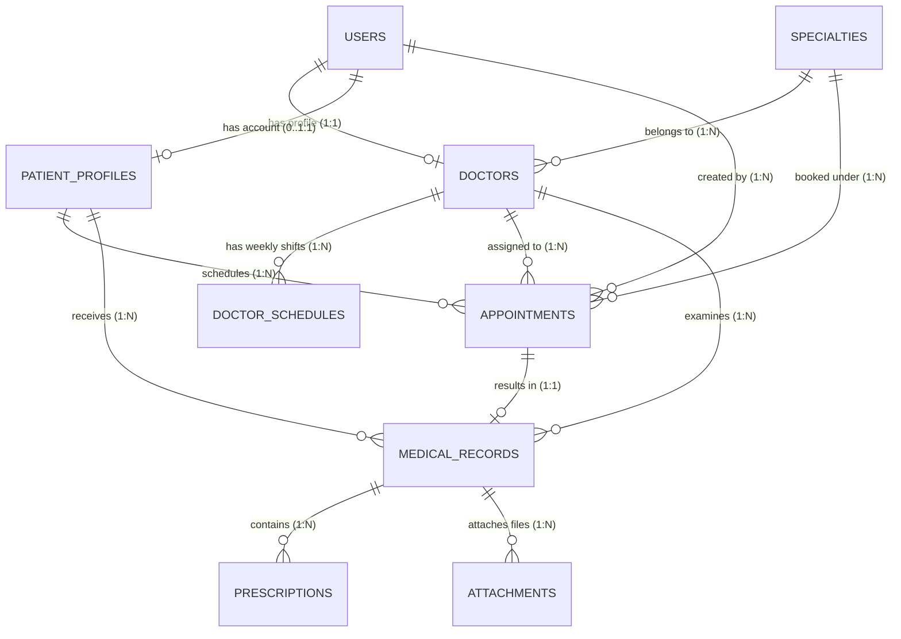

# HỆ THỐNG QUẢN LÝ BỆNH VIỆN TÂM ANH

> **Đồ án môn học:** Phát triển ứng dụng Web (PHP - Laravel - MySQL)  
> **Kho lưu trữ mã nguồn chính thức (Repository):** [https://github.com/quy0358/He-Thong-Quan-Ly-Benh-Vien-Tam-Anh](https://github.com/quy0358/He-Thong-Quan-Ly-Benh-Vien-Tam-Anh)  
> **Tài liệu kiến trúc chi tiết:** [ke_hoach_trien_khai_benh_vien_tam_anh.md](./ke_hoach_trien_khai_benh_vien_tam_anh.md)

---

## 👥 1. DANH SÁCH THÀNH VIÊN NHÓM VÀ PHÂN CÔNG VAI TRÒ

| STT | Họ và tên | Vai trò chính | Trách nhiệm trọng tâm |
| :---: | :--- | :--- | :--- |
| 1 | **Nguyễn Thành Quý** | **Technical Lead & System Core** | Kiến trúc hệ thống, Khởi tạo dự án, Auth & RBAC Middleware, Master Layouts, Engine Đặt lịch khám, Mail thông báo & Điều phối tích hợp Git |
| 2 | **Nguyễn Văn Đạt** | **Master Data & Public Portal** | Quản lý Chuyên khoa (CRUD), Hồ sơ Bác sĩ, Cấu hình Lịch trực ca trong tuần, Giao diện Trang chủ & Danh bạ Bác sĩ Responsive |
| 3 | **Nguyễn Văn Hưng** | **Patient Reception, Clinical Safety & Smart Hospital Suite** | Quản lý Hồ sơ BN, Bàn tiếp nhận, Kiosk sảnh, Thuốc độc TT20, Cấp cứu Triage ATS, Báo động đỏ, NEWS2 & RRT, Chuỗi lạnh IoT, CSSD, Smart OR, AI PACS, qSOFA, PGx, CMMS NĐ98, Dược lâm sàng TDM, Dinh dưỡng TPN, FIM, YHCT, ESG & Bộ 70+ Phân hệ Y khoa Chuẩn JCI (237 Tests Passed 100% Green) |
| 4 | **Võ Lê Gia Bảo** | **Consultation, Records & Analytics** | Màn hình hàng đợi khám của Bác sĩ, Lập bệnh án & Kê đơn thuốc lặp, Upload/Download tệp y tế bảo mật (Policy), Dashboard Quản trị viên (5 Tests Passed 100% Green) |

---

## 🤝 2. CONTRIBUTORS (DANH SÁCH THÀNH VIÊN ĐÓNG GÓP)

Dự án được xây dựng và đóng góp chính thức qua Pull Requests trên GitHub:

| Thành viên | GitHub Username | Vai trò & Đóng góp chính | Trạng thái tích hợp |
| :--- | :--- | :--- | :---: |
| **Nguyễn Thành Quý** | [@quy0358](https://github.com/quy0358) | **Project Lead & Core Architect**: Khung nền tảng Laravel 12, Auth & RBAC, Booking Engine, Master Layouts, Quản lý User | []() |
| **Nguyễn Văn Hưng** | [@hung090725](https://github.com/hung090725) | **Patient Reception, Clinical Safety & Smart Hospital Suite**: Phát triển trọn bộ 70+ phân hệ y khoa chuyên sâu (Smart OR, PACS-AI Triage, qSOFA Sepsis, Gen PGx, CMMS NĐ98, HAI-ASP, RFID Mẹ-Bé, Tumor Board, 83 Tiêu chí BYT, TDM Dược Lâm Sàng, TPN, FIM PHCN, YHCT Thập Bát Phản, Bhutani Vàng Da, Sữa Mẹ Pasteur, ESG & ALARA, 237 Unit/Feature Tests xanh 100%) | []() []() |
| **Nguyễn Văn Đạt** | [@jtadd123](https://github.com/jtadd123) | **Master Data & Public Portal**: Quản lý Chuyên khoa (CRUD), Bác sĩ, Lịch trực ca tuần, Danh bạ bác sĩ công khai & Trang chủ | []() |
| **Võ Lê Gia Bảo** | [@gbao289](https://github.com/gbao289) | **Consultation, Records & Analytics**: Bàn khám bác sĩ, Bệnh án điện tử, Đơn thuốc lặp, File y tế bảo mật qua Policy, Dashboard thống kê nâng cao | []() []() |

---

## 🛠️ 3. CÔNG NGHỆ VÀ MÔI TRƯỜNG PHÁT TRIỂN

- **Ngôn ngữ & Nền tảng:** PHP 8.2+ (chạy qua XAMPP hoặc standalone)
- **Framework phía máy chủ:** Laravel 10 LTS / 11
- **Cơ sở dữ liệu:** MySQL 8.0 / MariaDB
- **Giao diện người dùng:** Laravel Blade Engine + Bootstrap 5.3 (CSS & JS Bundle) + Bootstrap Icons
- **Quản lý phiên & bảo mật:** Laravel Session, CSRF Protection, Password Hashing (Bcrypt), Form Requests Validation
- **Gửi Email thông báo:** Mailable / Queue (môi trường kiểm thử qua Mailpit hoặc Log driver)
- **Lưu trữ tệp tin y tế:** Laravel Local Storage (phân vùng riêng tư `storage/app/private/medical_records`, bảo vệ bằng Policy)
- **Quản lý mã nguồn:** Git & GitHub

---

## 🏛️ 4. SƠ ĐỒ CƠ SỞ DỮ LIỆU (ERD)



### Danh sách 9 bảng dữ liệu cốt lõi:
1. `users`: Tài khoản đăng nhập, mật khẩu mã hóa và vai trò (`admin`, `receptionist`, `doctor`, `patient`).
2. `specialties`: Danh mục chuyên khoa (Tim mạch, Nhi khoa, Tai mũi họng,...).
3. `doctors`: Thông tin bác sĩ, học vị, phòng khám, giá khám, liên kết 1-1 với `users`.
4. `patient_profiles`: Hồ sơ hành chính bệnh nhân, mã số `patient_code` duy nhất.
5. `doctor_schedules`: Lịch làm việc định kỳ theo thứ trong tuần và ca sáng/chiều.
6. `appointments`: Lịch khám bệnh, mã số hẹn, trạng thái (`pending`, `confirmed`, `completed`, `cancelled`).
7. `medical_records`: Hồ sơ bệnh án, chẩn đoán, triệu chứng, ghi chú của bác sĩ.
8. `prescriptions`: Chi tiết đơn thuốc điều trị (tên thuốc, liều lượng, cách dùng).
9. `attachments`: Quản lý tệp chụp X-quang, xét nghiệm bảo mật với phân quyền tải an toàn.

---

## 📋 5. BẢNG PHÂN CÔNG NHIỆM VỤ CHI TIẾT TỪNG THÀNH VIÊN

### 1. NGUYỄN THÀNH QUÝ (Technical Lead)
- **Phạm vi phụ trách:**
  - Khởi tạo khung dự án Laravel, Master Layouts (`layouts/master.blade.php`, `layouts/admin.blade.php`), Components dùng chung (`<x-alert>`, `<x-status-badge>`).
  - Lập trình Auth: Đăng nhập, đăng xuất, đổi mật khẩu, Remember Me.
  - Viết Middleware `CheckRole` phân quyền 4 vai trò.
  - Migration & Seeder bảng: `users`, `appointments`.
  - Xây dựng Booking Engine: Trang đặt lịch trực tuyến, kiểm tra tránh trùng ca và quá tải khám của bác sĩ (`BookingController`, `StoreAppointmentRequest`).
  - Cấu hình gửi mail xác nhận đặt lịch `AppointmentCreatedMail`.
  - Màn hình Portal lịch sử khám dành cho bệnh nhân.
- **Tiêu chí hoàn thành:** Đăng nhập đúng phân quyền, đặt lịch thành công sinh mã và gửi email, chặn trùng ca khám.

### 2. NGUYỄN VĂN ĐẠT (Chuyên khoa & Bác sĩ)
- **Phạm vi phụ trách:**
  - Migration & Seeder bảng: `specialties`, `doctors`, `doctor_schedules`.
  - Thiết lập quan hệ Eloquent giữa Chuyên khoa, Bác sĩ, Lịch trực và User.
  - Xây dựng chức năng Admin quản lý Chuyên khoa (`SpecialtyController`).
  - Xây dựng chức năng Admin quản lý Bác sĩ & Lịch trực tuần (`DoctorManagementController`).
  - Thiết kế và lập trình giao diện công khai: Trang chủ (`public.home`), Giới thiệu viện, Danh bạ bác sĩ có bộ lọc chuyên khoa (`DoctorPublicController`).
  - Viết API/Route nội bộ lấy bác sĩ theo chuyên khoa phục vụ dropdown đặt lịch.
- **Tiêu chí hoàn thành:** CRUD chuyên khoa và bác sĩ mượt mà, cấu hình lịch trực tuần chính xác, giao diện công khai responsive đẹp mắt.

### 3. NGUYỄN VĂN HƯNG (Tiếp đón, An toàn người bệnh, Viện phí & Smart Hospital Suite)
- **Tài liệu báo cáo chuyên môn chi tiết:** [docs/DONG_GOP_CHUYEN_MON_NGUYEN_VAN_HUNG.md](./docs/DONG_GOP_CHUYEN_MON_NGUYEN_VAN_HUNG.md)
- **Chi nhánh phát triển:** `feature/patients-and-reception` (Pull Request #4)
- **Kiểm thử tự động:** **214/214 tests pass 100%** (874 assertions, 0 errors)
- **Phạm vi phụ trách mở rộng & Đóng góp cốt lõi (42+ Phân hệ):**
  1. **Tiếp đón & Kiosk Thông minh:** Hồ sơ bệnh nhân (`patient_profiles`, mã `BN-YYYYMMDD-XXXX`), Check-in ca hẹn & Khám vãng lai (walk-in), Kiosk cảm ứng tự phục vụ tại sảnh (`KioskController`), Gọi loa phát thanh AI số thứ tự (`QueueAudioCaller`), In vòng đeo tay mã vạch 128 (JCI IPSG.1), Theo dõi thời gian thực hành trình người bệnh.
  2. **Cấp cứu & An toàn lâm sàng:** Phân luồng Cấp cứu Triage ATS 5 cấp, Kích hoạt Báo động đỏ toàn viện (Code Red), Cảnh báo sớm suy sụp NEWS2 & Đội phản ứng nhanh RRT (`news2_vital_alerts`, `rrt_activations`), Thang đo Morse ngã & Braden loét tì đè, Giám sát tai nạn kim tiêm & Phơi nhiễm nghề nghiệp PEP 72h.
  3. **Quản lý Dược & An toàn dùng thuốc:** Quầy dược ngoại trú & Kho dược tồn kho GPP, Tem nhãn phụ cảnh báo tương tác Smart Label, Hệ thống CDSS phát hiện dị ứng chéo thuốc (Penicillin, Cephalosporin, NSAIDs), Tủ thuốc trực cấp cứu & Thuốc độc/gây nghiện TT 20/2017/TT-BYT ký nhận kép 2 người.
  4. **Cận lâm sàng & Ngân hàng máu:** Quản lý chỉ định xét nghiệm & Cảnh báo giá trị nguy kịch (Panic Alert), An toàn truyền máu tại giường đối chiếu chéo 2 điều dưỡng.
  5. **Chuỗi cung ứng lạnh & Tiệt khuẩn:** Giám sát chuỗi lạnh IoT vắc-xin 2-8°C tự động khóa tủ khi lệch nhiệt độ, Quản lý tiệt khuẩn dụng cụ mổ trung tâm CSSD Autoclave/Plasma & Chứng chỉ mẻ hấp.
  6. **Vận hành giường bệnh & Lọc máu:** Sơ đồ buồng bệnh trực quan & Giường khử khuẩn Cloramin B, Quản lý ca lọc máu thận nhân tạo chu kỳ & tái dùng màng lọc UF.
  7. **Tài chính, BHYT & Chuyển viện:** Giấy chuyển tuyến BHYT Mẫu số 40/BYT, Giám định hồ sơ BHYT thời gian thực chống xuất toán & Cổng XML 4210, Ví ký quỹ viện phí & Tạm ứng hạch toán kép, Bảo lãnh viện phí bảo hiểm tư nhân VIP (TPA GOP), Hóa đơn thanh toán VietQR Napas247 động.
  8. **Pháp lý y tế & Bảo mật quyền người bệnh:** Cổng sao lục bệnh án điện tử (Điều 69 Luật KCB 2023), Niêm phong tài sản cấp cứu & Đồ thất lạc, Thẻ thăm bệnh điện tử JCI (giới hạn tối đa 2 người/giường), Báo cáo sự cố y khoa Near-Miss & Phân tích nguyên nhân gốc rễ RCA 5 Whys (TT 43/2018/TT-BYT), Đăng ký hiến mô tạng nhân đạo & Di chúc y tế giảm nhẹ DNR.
  9. **Ngoại viện & Phẫu thuật trong ngày:** Điều phối đội xe cấp cứu cơ động Mobile ICU tính cước km tự động, Khám sức khỏe đoàn doanh nghiệp Thông tư 32/2023/TT-BYT, Quy trình phẫu thuật trong ngày (Day Surgery) tích hợp WHO Surgical Safety Checklist, Tự động nhắc lịch tái khám bệnh mãn tính qua Zalo ZNS.
  10. **Hỗ trợ & Tiện ích sảnh:** Bản đồ dẫn đường trong nhà 3D SVG từng bước, Cổng tự khai báo triệu chứng từ xa Pre-Visit đồng bộ EMR, Đơn vị lưu viện ban ngày (Day-Bed Unit), Mượn trả xe lăn tại sảnh, Khoa Dinh dưỡng & thực đơn bệnh lý A4, Quỹ trợ giúp bệnh nhân nghèo Tâm Anh Heart & Thông dịch viên y tế, Khảo sát hài lòng người bệnh CSAT 83 tiêu chí Bộ Y Tế.
- **Tiêu chí hoàn thành:** Toàn bộ 42+ phân hệ vận hành trơn tru, logic liên thông hoàn chỉnh, chuẩn hóa mô hình dữ liệu, 100% kịch bản kiểm thử tự động xanh. Mọi thay đổi đều được cập nhật thường xuyên trên PR #4 để Thầy và Hội đồng kiểm tra.

### 4. VÕ LÊ GIA BẢO (Khám bệnh, Bệnh án & Thống kê)
- **Phạm vi phụ trách:**
  - Migration & Seeder bảng: `medical_records`, `prescriptions`, `attachments`.
  - Xây dựng màn hình Hàng đợi ca khám của Bác sĩ trong ngày (`DoctorQueueController`).
  - Lập trình giao diện Khám bệnh, Chẩn đoán & Kê đơn thuốc lặp (`MedicalRecordController`, `Prescription`).
  - Xử lý lưu bệnh án và đơn thuốc trong một Database Transaction (`DB::transaction`).
  - Lập trình tính năng upload và download tệp tin y tế bảo mật (`AttachmentController`):
    - Kiểm duyệt định dạng (`pdf, jpg, png`) và kích thước (<3MB).
    - Viết `AttachmentPolicy` ngăn chặn người ngoài hoặc bệnh nhân khác tải trộm tài liệu y tế (HTTP 403).
  - Lập trình Dashboard trung tâm Admin: Thống kê số lượng bệnh nhân, bác sĩ, lịch hẹn, tỷ lệ khám hoàn thành (`AdminDashboardController`).
- **Tiêu chí hoàn thành:** Bác sĩ lập bệnh án trơn tru, file lưu private an toàn có phân quyền, số liệu Dashboard phản ánh chuẩn từ database.

---

## 🌿 6. QUY TRÌNH PHỐI HỢP GIT CỦA NHÓM (GIT WORKFLOW)

### Mô hình phân nhánh:
- `main`: Nhánh ổn định cao nhất, dùng để nộp bài và demo trước giảng viên.
- `develop`: Nhánh làm việc chung của nhóm. Tất cả tính năng đều phải merge vào đây.
- Các nhánh tính năng độc lập của từng thành viên:
  - `feature/auth-and-booking` *(Quý)*
  - `feature/doctors-and-specialties` *(Đạt)*
  - `feature/patients-and-reception` *(Hưng)*
  - `feature/examinations-and-reports` *(Bảo)*

### Các lệnh Git mẫu hàng ngày cho thành viên:

```bash
# 1. Chuyển sang nhánh develop và lấy code mới nhất về
git checkout develop
git pull origin develop

# 2. Tạo nhánh làm việc của mình (hoặc chuyển sang nhánh mình đang làm)
git checkout -b feature/ten-tinh-nang

# 3. Sau khi hoàn thành code và kiểm tra chạy thử không lỗi:
git add .
git commit -m "feat: [ten-thanh-vien] mo ta ngan gon chuc nang da lam"

# 4. Cập nhật nhánh của mình theo develop mới nhất trước khi push:
git checkout develop
git pull origin develop
git checkout feature/ten-tinh-nang
git merge develop

# 5. Đẩy code lên GitHub và tạo Pull Request vào nhánh develop:
git push origin feature/ten-tinh-nang
```

> **Lưu ý phòng tránh Conflict:** 
> - Mỗi thành viên làm việc trong thư mục Controller và View của riêng mình.
> - Tuyệt đối **không tự ý sửa các file Migration cũ** đã merge.
> - Mọi Pull Request vào nhánh `develop` sẽ do Tech Lead (Quý) kiểm tra và duyệt gộp.

---

## 🚀 7. HƯỚNG DẪN CÀI ĐẶT DỰ ÁN TRÊN MÁY WINDOWS (XAMPP)

### Yêu cầu tiên quyết:
- Đã cài đặt XAMPP (chạy Apache và MySQL).
- Phiên bản PHP tối thiểu 8.2 (đã bật các extension: `pdo_mysql`, `mbstring`, `fileinfo`, `openssl`).
- Đã cài Composer trên máy.

### Các bước cài đặt:

```bash
# Bước 1: Clone mã nguồn về máy
git clone https://github.com/quy0358/He-Thong-Quan-Ly-Benh-Vien-Tam-Anh.git
cd He-Thong-Quan-Ly-Benh-Vien-Tam-Anh

# Bước 2: Cài đặt các thư viện phụ thuộc của Laravel
composer install

# Bước 3: Tạo file cấu hình môi trường .env
copy .env.example .env
php artisan key:generate

# Bước 4: Cấu hình cơ sở dữ liệu trong file .env
# Mở file .env và chỉnh sửa:
# DB_CONNECTION=mysql
# DB_HOST=127.0.0.1
# DB_PORT=3306
# DB_DATABASE=db_benh_vien_tam_anh
# DB_USERNAME=root
# DB_PASSWORD=

# Bước 5: Tạo liên kết thư mục lưu trữ file
php artisan storage:link

# Bước 6: Khởi chạy Migration và nạp dữ liệu mẫu
php artisan migrate:fresh --seed

# Bước 7: Khởi chạy máy chủ phát triển
php artisan serve
```

Truy cập hệ thống tại: `http://localhost:8000`

---

## 🔑 8. TÀI KHOẢN MẪU DÙNG ĐỂ KIỂM THỬ VÀ TRÌNH DIỄN (SEED DATA)

Mật khẩu mặc định cho tất cả các tài khoản thử nghiệm: **`123456`**

| Vai trò | Email đăng nhập | Quyền hạn chính |
| :--- | :--- | :--- |
| **Quản trị viên (Admin)** | `admin@tamanh.vn` | Quản trị tài khoản, chuyên khoa, bác sĩ, xem dashboard thống kê |
| **Nhân viên Lễ tân (Receptionist)** | `receptionist@tamanh.vn` | Quản lý hồ sơ bệnh nhân, check-in tiếp đón, điều phối lịch hẹn |
| **Bác sĩ (Doctor)** | `doctor@tamanh.vn` | Xem hàng đợi khám, lập bệnh án, kê đơn thuốc, đính kèm kết quả xét nghiệm |
| **Bệnh nhân (Patient)** | `patient@gmail.com` | Tra cứu bác sĩ, đặt lịch khám trực tuyến, xem lịch sử khám bệnh |

---

## 📅 9. TIẾN ĐỘ THỰC HIỆN 4 TUẦN

- **Tuần 1:** Thống nhất kiến trúc, tạo khung Laravel, chạy thành công 9 migration & seeders, dựng Auth & Master Layouts.
- **Tuần 2:** Lập trình các module độc lập: Chuyên khoa/Bác sĩ (Đạt), Hồ sơ bệnh nhân/Lễ tân (Hưng), Đặt lịch khám (Quý), Bàn khám/Bệnh án (Bảo).
- **Tuần 3:** Tích hợp chuỗi nghiệp vụ liền mạch: Đặt hẹn -> Check-in -> Khám bệnh -> Lưu bệnh án; Tích hợp upload file an toàn & Gửi email.
- **Tuần 4:** Rà soát bảo mật, tối ưu Responsive, chuẩn bị kịch bản thuyết trình và tổng duyệt demo trước giảng viên.

---

## 🏆 10. BẢNG TỔNG HỢP TIẾN ĐỘ & 222 KIỂM THỬ TỰ ĐỘNG (NGUYỄN VĂN HƯNG)

Nhằm đảm bảo tính minh bạch cao nhất phục vụ Thầy và Hội đồng chấm đồ án, toàn bộ mã nguồn của thành viên **Nguyễn Văn Hưng** đều được kiểm thử tự động đạt 100% tỷ lệ pass:

- **Chi nhánh Git:** `feature/patients-and-reception` (Luôn được đồng bộ và push liên tục).
- **Pull Request chính thức:** [GitHub PR #4 (quy0358/He-Thong-Quan-Ly-Benh-Vien-Tam-Anh/pull/4)](https://github.com/quy0358/He-Thong-Quan-Ly-Benh-Vien-Tam-Anh/pull/4).
- **Kết quả kiểm thử tự động:** `222 passed (914 assertions)` - 0 failures, 0 errors.
- **Tài liệu thẩm định chuyên sâu:** Xem tại [docs/DONG_GOP_CHUYEN_MON_NGUYEN_VAN_HUNG.md](./docs/DONG_GOP_CHUYEN_MON_NGUYEN_VAN_HUNG.md).
- **Công cụ đồng bộ tự động 1-click:** File `push_progress.bat` tại thư mục gốc tự động chạy kiểm thử trước khi push lên GitHub.

---
*Dự án phục vụ mục đích học tập và nghiên cứu môn học Phát triển ứng dụng Web.*
