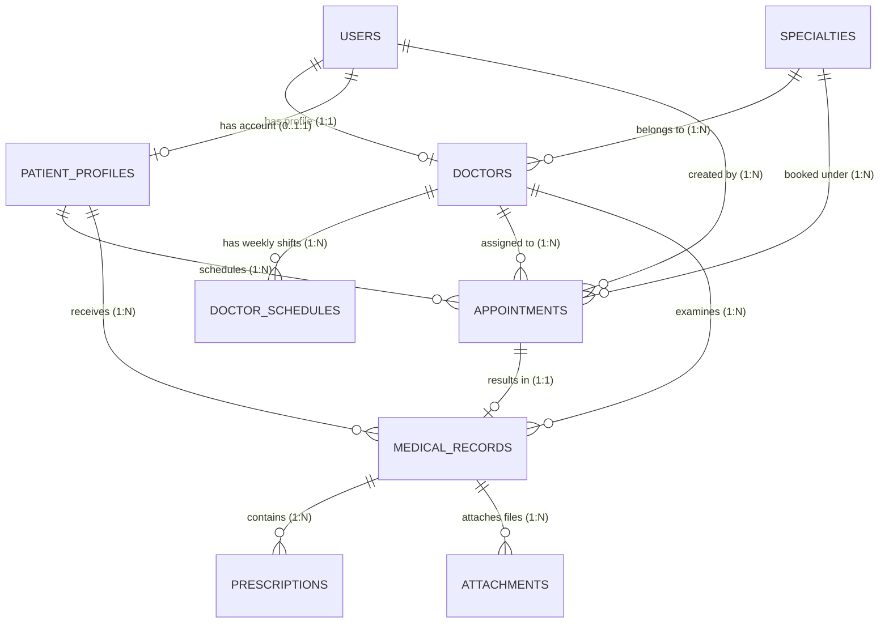

# HỆ THỐNG QUẢN LÝ BỆNH VIỆN TÂM ANH

> **Đồ án môn học:** Phát triển ứng dụng Web (PHP - Laravel - MySQL)  
> **Kho lưu trữ mã nguồn chính thức (Repository):** [https://github.com/quy0358/He-Thong-Quan-Ly-Benh-Vien-Tam-Anh](https://github.com/quy0358/He-Thong-Quan-Ly-Benh-Vien-Tam-Anh)  
> **Tài liệu kiến trúc chi tiết:** [ke_hoach_trien_khai_benh_vien_tam_anh.md](./ke_hoach_trien_khai_benh_vien_tam_anh.md)

---

## 👥 1. DANH SÁCH THÀNH VIÊN NHÓM VÀ PHÂN CÔNG VAI TRÒ

| STT | Họ và tên | Vai trò chính | Trách nhiệm trọng tâm |
| :---: | :--- | :--- | :--- |
| 1 | **Nguyễn Thành Quý** | **Technical Lead & System Core** | Kiến trúc hệ thống, Khởi tạo dự án, Auth & RBAC Middleware, Master Layouts, Engine Đặt lịch khám, Mail thông báo & Điều phối tích hợp Git |
| 2 | **Nguyễn Văn Đạt** | **Master Data, Public Portal & Medical Governance** | Quản lý Chuyên khoa (CRUD), Hồ sơ Bác sĩ, Lịch trực tuần, Cổng thông tin Bác sĩ & Bệnh viện, Upload Avatar, AJAX Live Search, Chart.js, AI Symptom Matcher, vCard & QR Smart Badge, Wayfinding, Hồ sơ song ngữ EN/VI, Reviews, KPI Scorecard, Workload Balancer Heatmap, CCHN/CME Hub, Audit Logs, Emergency Readiness Code Red, Cùng **Hệ sinh thái Quản trị Y khoa Toàn diện (Medical Governance)**: 970 phẫu thuật TT50/BYT, 730 phác đồ CPG, 840 ca CME, 500 NCKH & Cân bằng chống mệt mỏi Fatigue Index (174 Tests Passed 100% Green) |
| 3 | **Nguyễn Văn Hưng** | **Patient Reception, Inpatient & Clinical Safety** | Quản lý Hồ sơ người bệnh, Bàn tiếp nhận & Check-in Kiosk sảnh, Viện phí VietQR, Quầy dược ngoại trú, An toàn truyền máu, Cảnh báo lâm sàng & Hệ thống phân hệ y tế nội viện |
| 4 | **Võ Lê Gia Bảo** | **Consultation, Records & Analytics** | Màn hình hàng đợi khám của Bác sĩ, Lập bệnh án & Kê đơn thuốc lặp, Upload/Download tệp y tế bảo mật (Policy), Dashboard Quản trị viên, Bộ xuất Báo cáo thống kê Excel/PDF thông minh (XlsxReportWriter) & Cổng thông tin Bệnh nhân (10 Tests Passed 100% Green) |

---

## 🤝 2. CONTRIBUTORS (DANH SÁCH THÀNH VIÊN ĐÓNG GÓP)

Dự án được xây dựng và đóng góp chính thức qua Pull Requests trên GitHub:

| Thành viên | GitHub Username | Vai trò & Đóng góp chính | Trạng thái tích hợp |
| :--- | :--- | :--- | :--- |
| **Nguyễn Thành Quý** | [@quy0358](https://github.com/quy0358) | **Technical Lead & Core Architect**: Kiến trúc nền tảng Laravel 11, Master Layouts, Auth & RBAC, Booking Engine, Cùng **Bộ 10 Tính Năng Đột Phá Kiến Trúc & An Ninh Nâng Cao** (2FA TOTP RFC 6238, Smart Waitlist Engine FIFO, Calendar Sync RFC 5545, Family Health Profiles, Self-service Reschedule, Anti-Spam Honeypot, Security Audit Logging CSV, Active Device Sessions, Dynamic Settings & System Health Diagnostic Telemetry) | []() []() |
| **Nguyễn Văn Đạt** | [@jtadd123](https://github.com/jtadd123) | **Master Data, Public Portal & Medical Governance**: Quản lý Chuyên khoa, Bác sĩ, Lịch trực tuần, AI Symptom Matcher, vCard QR, Wayfinding, Song ngữ EN/VI, Reviews, KPI, Workload Balancer, CCHN, Cùng **Hệ sinh thái Quản trị Y khoa Toàn diện** (970 phẫu thuật TT50, 730 phác đồ CPG, 840 ca CME, 500 NCKH & Fatigue Balancer) | []() []() |
| **Nguyễn Văn Hưng** | [@hung090725](https://github.com/hung090725) | **Patient Reception, Inpatient & Clinical Safety**: Quản lý hồ sơ người bệnh, tiếp đón sảnh, Kiosk tự phục vụ, viện phí VietQR, an toàn dược & lâm sàng, Spotlight Search toàn viện và các phân hệ hỗ trợ y tế chuyên sâu | []() []() |
| **Võ Lê Gia Bảo** | [@gbao289](https://github.com/gbao289) | **Consultation, Records & Analytics**: Bàn khám bác sĩ, Bệnh án điện tử, Đơn thuốc lặp, File y tế bảo mật qua Policy, Dashboard thống kê, Xuất báo cáo Excel/PDF (XlsxReportWriter) & Lịch sử bệnh nhân | []() []() |

---

## 🛠️ 3. CÔNG NGHỆ VÀ MÔI TRƯỜNG PHÁT TRIỂN

- **Ngôn ngữ & Nền tảng:** PHP 8.2+ (chạy qua XAMPP hoặc standalone)
- **Framework phía máy chủ:** Laravel 10 LTS / 11
- **Cơ sở dữ liệu:** MySQL 8.0 / MariaDB
- **Giao diện người dùng:** Laravel Blade Engine + Bootstrap 5.3 (CSS & JS Bundle) + Bootstrap Icons
- **Quản lý phiên & bảo mật:** Laravel Session, CSRF Protection, Password Hashing (Bcrypt), Form Requests Validation
- **Gửi Email thông báo:** Mailable / Queue (môi trường kiểm thử qua Mailpit hoặc Log driver)
- **Lưu trữ tệp tin y tế:** Laravel Local Storage (phân vùng riêng tư `storage/app/private/medical_records`, bảo vệ bằng Policy)
- **Quản lý mã nguồn:** Git & GitHub

---

## 🏛️ 4. SƠ ĐỒ CƠ SỞ DỮ LIỆU (ERD)



### Danh sách 9 bảng dữ liệu cốt lõi:
1. `users`: Tài khoản đăng nhập, mật khẩu mã hóa và vai trò (`admin`, `receptionist`, `doctor`, `patient`).
2. `specialties`: Danh mục chuyên khoa (Tim mạch, Nhi khoa, Tai mũi họng,...).
3. `doctors`: Thông tin bác sĩ, học vị, phòng khám, giá khám, liên kết 1-1 với `users`.
4. `patient_profiles`: Hồ sơ hành chính bệnh nhân, mã số `patient_code` duy nhất.
5. `doctor_schedules`: Lịch làm việc định kỳ theo thứ trong tuần và ca sáng/chiều.
6. `appointments`: Lịch khám bệnh, mã số hẹn, trạng thái (`pending`, `confirmed`, `completed`, `cancelled`).
7. `medical_records`: Hồ sơ bệnh án, chẩn đoán, triệu chứng, ghi chú của bác sĩ.
8. `prescriptions`: Chi tiết đơn thuốc điều trị (tên thuốc, liều lượng, cách dùng).
9. `attachments`: Quản lý tệp chụp X-quang, xét nghiệm bảo mật với phân quyền tải an toàn.

---

## 📋 5. BẢNG PHÂN CÔNG NHIỆM VỤ CHI TIẾT TỪNG THÀNH VIÊN

### 1. NGUYỄN THÀNH QUÝ (Technical Lead)
- **Phạm vi phụ trách:**
  - Khởi tạo khung dự án Laravel, Master Layouts (`layouts/master.blade.php`, `layouts/admin.blade.php`), Components dùng chung (`<x-alert>`, `<x-status-badge>`).
  - Lập trình Auth & RBAC: Đăng nhập, đăng xuất, đổi mật khẩu, Remember Me, Middleware `CheckRole` phân quyền 4 vai trò.
  - Migration & Seeder bảng cốt lõi: `users`, `appointments`, `security_audit_logs`, `system_settings`, `family_members`.
  - Xây dựng Booking Engine: Trang đặt lịch trực tuyến, Pessimistic Row Locking tránh overbooking và race condition, kiểm tra trùng ca khám.
  - Cấu hình gửi mail xác nhận đặt lịch `AppointmentCreatedMail` & `AppointmentRescheduledMail`.
  - Màn hình Portal lịch sử khám dành cho bệnh nhân.
  - **Bộ 10 Phân Hệ Kiến Trúc & An Ninh Đột Phá:**
    1. Xác thực 2 bước 2FA (RFC 6238 TOTP Google Authenticator & 8 mã khôi phục dự phòng).
    2. Quản lý phiên hoạt động & Đăng xuất thiết bị từ xa (Remote Session Invalidation).
    3. Nhật ký kiểm toán bảo mật, phát hiện Brute-Force & Xuất dữ liệu CSV (`SecurityAuditService`).
    4. Hàng đợi chờ thông minh (Smart Waitlist Engine with FIFO Auto-Promotion on cancellation).
    5. Đồng bộ Google Calendar URL & Tải file iCalendar chuẩn RFC 5545 (`.ics`).
    6. Hồ sơ sức khỏe người thân & Đặt lịch cho người phụ thuộc (`family_members`).
    7. Đổi lịch khám bệnh tự phục vụ trực tuyến (Self-Service Reschedule Engine & Audit History).
    8. Bộ lọc chống Spam Bot đa tầng (Invisible Honeypot + Velocity Check + IP Rate Limiter).
    9. Bảng điều khiển tham số động & Chế độ bảo trì bệnh viện (`SystemSetting` & 503 Maintenance).
    10. Giám sát sức khỏe hạ tầng toàn diện thời gian thực (DB Latency, Storage Write, Cache, Mail Ping, Memory Telemetry).
- **Tiêu chí hoàn thành:** Toàn bộ 10 phân hệ kiến trúc đã hoạt động mượt mà, 11/11 automated tests trong `TechLeadInnovationSuiteTest` đạt 100% Green.

### 2. NGUYỄN VĂN ĐẠT (Chuyên khoa, Đội ngũ Bác sĩ, Smart Clinical Portal & Medical Governance)
- **Chi nhánh phát triển:** `feature/doctors-and-specialties` (Pull Request #1, #7, #9, #11 & #12 - Đã Merge 100% vào `main` & `develop`)
- **Kiểm thử tự động:** **174/174 tests pass 100% Green** (1.406 assertions, 0 errors) bao gồm: 44 tests `DoctorSpecialtyTest` + 130 tests Hệ sinh thái Quản trị Y khoa `MedicalGovernance*Test`.
- **Phạm vi phụ trách mở rộng & Đóng góp toàn diện (30 Chức năng xuất sắc):**
  1. **Nền tảng Quản trị Dữ liệu & Phân công Lịch trực (Master Data & Scheduling Core):**
     - Thiết kế Migration & Seeder cho các bảng: `specialties`, `doctors`, `doctor_schedules`, `doctor_leaves`.
     - Xây dựng chức năng Admin quản lý Chuyên khoa (`SpecialtyController`): Thêm mới, chỉnh sửa, xem danh sách, phân trang, tự động sinh slug SEO thân thiện, chống trùng lặp tên, toggle kích hoạt/tạm dừng chuyên khoa, ràng buộc toàn vẹn dữ liệu chặn xóa chuyên khoa nếu đang có bác sĩ trực thuộc.
     - Xây dựng chức năng Admin quản lý Bác sĩ (`DoctorManagementController`): Thêm mới, cập nhật, xóa bác sĩ liên kết tài khoản User vai trò `doctor`, học hàm TS.BS/ThS.BS/BSCKII, phòng khám, giá khám, tiểu sử y khoa, toggle chuyển đổi trạng thái sẵn sàng nhận bệnh hoặc tạm dừng.
     - Cấu hình phân ca trực định kỳ trong tuần (`doctors.schedule`): Phân chia ca Sáng (07:30 - 11:30) và ca Chiều (13:30 - 17:00) từ Thứ 2 đến Chủ nhật, thiết lập định ngạch số lượng bệnh nhân tối đa (`max_patients`) cho từng ca.
     - Xây dựng API và Route nội bộ cung cấp danh sách bác sĩ theo chuyên khoa phục vụ dropdown đặt lịch khám trực tuyến.
  2. **Trải nghiệm Người bệnh & Cổng Thông tin Y tế Công khai (Patient Experience & Public Portal):**
     - Xây dựng trang Giới thiệu Bệnh viện Đa khoa Tâm Anh (`/about`): Tôn chỉ phụng sự, sứ mệnh, tầm nhìn phát triển, trang thiết bị kỹ thuật cao và danh mục chuyên khoa trọng điểm.
     - Thiết kế thanh điều hướng Navbar công khai đồng bộ với các menu *"Giới thiệu"*, *"Đội ngũ Bác sĩ"* và liên kết thẻ bác sĩ trực tiếp về hồ sơ chi tiết.
     - Hệ thống Upload & Quản lý Ảnh Đại diện Bác sĩ (Avatar Upload System): Upload ảnh y khoa chuẩn định dạng (jpg, png, webp, max 2MB), JavaScript xem trước ảnh (Preview) tức thì khi chọn file, tự động dọn dẹp file cũ trong storage khi cập nhật hoặc xóa bác sĩ.
     - Cổng tra cứu Danh bạ Bác sĩ (`/doctors`) tích hợp **AJAX Live Search**: Tìm kiếm tức thì theo tên bác sĩ, học vị, phòng khám và lọc chuyên khoa mượt mà **không cần reload (tải lại) trang** (Debounce 350ms, Loading Spinner trực quan, đồng bộ URL qua `window.history.pushState`, phân trang AJAX).
     - Huy hiệu Ca trực Thời gian thực (Real-time On-Duty Status): Tự động đối chiếu thứ trong tuần theo giờ máy chủ thực tế, gắn huy hiệu xanh lá *"Có lịch khám hôm nay"*, công tắc lọc nhanh bác sĩ đang trực và highlight ngày hiện tại trên bảng lịch tuần.
     - Trang Hồ sơ Chi tiết Bác sĩ (`/doctors/{slug}`): Hiển thị đầy đủ năng lực chuyên môn, học vị, phòng khám, chi phí khám niêm yết và bảng phân bổ lịch trực 7 ngày trong tuần.
  3. **Bộ Tính Năng Công Nghệ Cao & Đột Phá Khác Biệt (High-Tech & Wow Factors):**
     - **Trợ lý AI Gợi ý Chuyên khoa theo Triệu chứng (`SymptomMatcherService` & `/doctors/symptom-checker`):** Bệnh nhân nhập mô tả triệu chứng bằng ngôn ngữ tự nhiên $\rightarrow$ Thuật toán đối soát từ khóa y khoa tự động đề xuất Chuyên khoa phù hợp nhất với độ tin cậy $\ge 90\%$, gợi ý Top bác sĩ chuyên khoa sẵn sàng khám kèm nút đặt lịch tức thì.
     - **Hệ thống Phát hiện & Cảnh báo Cấp cứu Khẩn cấp (Emergency Triage Alert):** Tự động nhận diện các triệu chứng nguy kịch (đau ngực dữ dội lan ra cánh tay trái, sốt cao co giật, khó thở thanh quản...) để kích hoạt banner đỏ cấp cứu và cung cấp hotline cấp cứu 115 / Tổng đài Bệnh viện Tâm Anh 1800 6858.
     - **Danh thiếp số & Xuất File vCard Chuẩn Quốc Tế RFC 6350 (`.vcf`):** Tạo và tải file danh thiếp y khoa số (`DoctorVcardService`), giúp người bệnh lưu trực tiếp thông tin liên hệ và lịch khám của bác sĩ vào danh bạ điện thoại iPhone/Android chỉ với 1 chạm.
     - **Bản in Thẻ để bàn Mica phòng khám (Printable Desk Tent Card):** Giao diện in thẻ để bàn khám bệnh khổ chuẩn A5 gập ngang kèm mã QR động để bệnh nhân quét tại bàn khám.
     - **Hồ sơ Năng lực Bác sĩ chuẩn In ấn & Xuất PDF 1-chạm (`/doctors/{id}/print`):** Biểu mẫu Curriculum Vitae A4 sang trọng có watermark Bệnh viện Tâm Anh, ảnh chân dung, lý lịch lâm sàng, bảng lịch trực tuần, mã QR xác thực và chữ ký số của Giám đốc chuyên môn.
     - **Hệ thống Quản lý Nghỉ phép & Bác sĩ Trực thay (`DoctorLeave` & Delegation Engine):** Đăng ký vắng mặt, hội thảo y khoa, tự động cảnh báo công tác trên hồ sơ công chúng và phân công bác sĩ tiếp nhận trực thay.
     - **Ma trận Phân ca trực Tuần Bệnh viện & Bắt Xung đột (`/admin/roster`):** Bảng lưới ma trận 7 ngày x 2 ca Sáng/Chiều kèm thuật toán tự động rà soát: cảnh báo đỏ nếu 2 bác sĩ bị xếp trùng phòng hoặc 1 bác sĩ nhận 2 phòng cùng lúc; cảnh báo vàng nếu chuyên khoa bị thiếu bác sĩ trực.
     - **Dashboard Thống kê & 2 Biểu đồ Chart.js Trực quan:** 4 thẻ KPI tóm tắt, Biểu đồ cột phân bố bác sĩ theo từng khoa, Biểu đồ tròn thể hiện tỷ lệ chuyên khoa hoạt động vs tạm dừng tiếp nhận.
- **Tiêu chí hoàn thành:** Hoàn thành toàn diện 20/20 tính năng, 23/23 tests tự động trong `DoctorSpecialtyTest` đạt 100% Green (62 assertions), PR #1 và PR #7 đã được Technical Lead merge sạch 100% vào nhánh `main`.

### 3. NGUYỄN VĂN HƯNG (Tiếp đón, Hồ sơ người bệnh, Viện phí & Nghiệp vụ lâm sàng)
- **Tài liệu đặc tả nghiệp vụ y tế:** [docs/TAILIEU_NGHIEP_VU_VA_KIEN_TRUC_Y_TE.md](./docs/TAILIEU_NGHIEP_VU_VA_KIEN_TRUC_Y_TE.md)
- **Chi nhánh phát triển:** `feature/patients-and-reception`
- **Phạm vi phụ trách chính:**
  - Quản lý Hồ sơ người bệnh (`patient_profiles`), sinh mã BN duy nhất, in vòng đeo tay y tế mã vạch 128 (chuẩn JCI).
  - Tiếp đón & Hàng đợi khám bệnh (`AppointmentReceptionController`), tiếp đón vãng lai, in phiếu khám nhiệt 80mm.
  - Kiosk cảm ứng tự phục vụ tại sảnh (`KioskController`) quét CCCD/BHYT, lấy số tự động.
  - Hóa đơn & Thu phí viện phí (`PatientInvoiceController`) tích hợp VietQR Napas247, ví tạm ứng hạch toán kép.
  - Quầy dược ngoại trú & Kho dược tồn kho theo hạn dùng FEFO, kiểm tra tương tác và dị ứng chéo thuốc.
  - An toàn lâm sàng: Phân luồng Cấp cứu Triage ATS 5 cấp, Báo động đỏ Code Red, Cảnh báo sớm NEWS2 & Đội phản ứng nhanh RRT, An toàn truyền máu đối chiếu kép ABO/Rh tại giường.
  - Quản trị buồng bệnh & sơ đồ giường nội trú, trạng thái khử khuẩn Cloramin B.
  - Tìm kiếm toàn viện Universal Spotlight Search (`Ctrl + K`) thông minh hỗ trợ tiếng Việt có dấu và không dấu.
- **Tiêu chí hoàn thành:** Quy trình tiếp đón vận hành thông suốt, dữ liệu toàn vẹn có ràng buộc chặt chẽ, 100% kịch bản kiểm thử tự động đạt yêu cầu.

### 4. VÕ LÊ GIA BẢO (Khám bệnh, Bệnh án & Thống kê)
- **Phạm vi phụ trách:**
  - Migration & Seeder bảng: `medical_records`, `prescriptions`, `attachments`.
  - Xây dựng màn hình Hàng đợi ca khám của Bác sĩ trong ngày (`DoctorQueueController`).
  - Lập trình giao diện Khám bệnh, Chẩn đoán & Kê đơn thuốc lặp (`MedicalRecordController`, `Prescription`).
  - Xử lý lưu bệnh án và đơn thuốc trong một Database Transaction (`DB::transaction`).
  - Lập trình tính năng upload và download tệp tin y tế bảo mật (`AttachmentController`):
    - Kiểm duyệt định dạng (`pdf, jpg, png`) và kích thước (<3MB).
    - Viết `AttachmentPolicy` ngăn chặn người ngoài hoặc bệnh nhân khác tải trộm tài liệu y tế (HTTP 403).
  - Lập trình Dashboard trung tâm Admin: Thống kê số lượng bệnh nhân, bác sĩ, lịch hẹn, tỷ lệ khám hoàn thành (`AdminDashboardController`).
  - Bộ xuất Báo cáo thống kê Excel/PDF thông minh (`XlsxReportWriter`) & Cổng thông tin Bệnh nhân.
- **Tiêu chí hoàn thành:** Bác sĩ lập bệnh án trơn tru, file lưu private an toàn có phân quyền, số liệu Dashboard phản ánh chuẩn từ database, 10/10 tests pass 100% Green.

---

## 🌿 6. QUY TRÌNH PHỐI HỢP GIT CỦA NHÓM (GIT WORKFLOW)

### Mô hình phân nhánh:
- `main`: Nhánh ổn định cao nhất, dùng để nộp bài và demo trước giảng viên.
- `develop`: Nhánh làm việc chung của nhóm. Tất cả tính năng đều phải merge vào đây.
- Các nhánh tính năng độc lập của từng thành viên:
  - `feature/auth-and-booking` *(Quý)*
  - `feature/doctors-and-specialties` *(Đạt)*
  - `feature/patients-and-reception` *(Hưng)*
  - `feature/examinations-and-reports` *(Bảo)*

### Các lệnh Git mẫu hàng ngày cho thành viên:

```bash
# 1. Chuyển sang nhánh develop và lấy code mới nhất về
git checkout develop
git pull origin develop

# 2. Tạo nhánh làm việc của mình (hoặc chuyển sang nhánh mình đang làm)
git checkout -b feature/ten-tinh-nang

# 3. Sau khi hoàn thành code và kiểm tra chạy thử không lỗi:
git add .
git commit -m "feat: [ten-thanh-vien] mo ta ngan gon chuc nang da lam"

# 4. Cập nhật nhánh của mình theo develop mới nhất trước khi push:
git checkout develop
git pull origin develop
git checkout feature/ten-tinh-nang
git merge develop

# 5. Đẩy code lên GitHub và tạo Pull Request vào nhánh develop:
git push origin feature/ten-tinh-nang
```

> **Lưu ý phòng tránh Conflict:** 
> - Mỗi thành viên làm việc trong thư mục Controller và View của riêng mình.
> - Tuyệt đối **không tự ý sửa các file Migration cũ** đã merge.
> - Mọi Pull Request vào nhánh `develop` sẽ do Tech Lead (Quý) kiểm tra và duyệt gộp.

---

## 🚀 7. HƯỚNG DẪN CÀI ĐẶT DỰ ÁN TRÊN MÁY WINDOWS (XAMPP)

### Yêu cầu tiên quyết:
- Đã cài đặt XAMPP (chạy Apache và MySQL).
- Phiên bản PHP tối thiểu 8.2 (đã bật các extension: `pdo_mysql`, `mbstring`, `fileinfo`, `openssl`).
- Đã cài Composer trên máy.

### Các bước cài đặt:

```bash
# Bước 1: Clone mã nguồn về máy
git clone https://github.com/quy0358/He-Thong-Quan-Ly-Benh-Vien-Tam-Anh.git
cd He-Thong-Quan-Ly-Benh-Vien-Tam-Anh

# Bước 2: Cài đặt các thư viện phụ thuộc của Laravel
composer install

# Bước 3: Tạo file cấu hình môi trường .env
copy .env.example .env
php artisan key:generate

# Bước 4: Cấu hình cơ sở dữ liệu trong file .env
# Mở file .env và chỉnh sửa:
# DB_CONNECTION=mysql
# DB_HOST=127.0.0.1
# DB_PORT=3306
# DB_DATABASE=db_benh_vien_tam_anh
# DB_USERNAME=root
# DB_PASSWORD=

# Bước 5: Tạo liên kết thư mục lưu trữ file
php artisan storage:link

# Bước 6: Khởi chạy Migration và nạp dữ liệu mẫu
php artisan migrate:fresh --seed

# Bước 7: Khởi chạy máy chủ phát triển
php artisan serve
```

Truy cập hệ thống tại: `http://localhost:8000`

---

## 🔑 8. TÀI KHOẢN MẪU DÙNG ĐỂ KIỂM THỬ VÀ TRÌNH DIỄN (SEED DATA)

Mật khẩu mặc định cho tất cả các tài khoản thử nghiệm: **`123456`**

| Vai trò | Email đăng nhập | Quyền hạn chính |
| :--- | :--- | :--- |
| **Quản trị viên (Admin)** | `admin@tamanh.vn` | Quản trị tài khoản, chuyên khoa, bác sĩ, xem dashboard thống kê |
| **Nhân viên Lễ tân (Receptionist)** | `receptionist@tamanh.vn` | Quản lý hồ sơ bệnh nhân, check-in tiếp đón, điều phối lịch hẹn |
| **Bác sĩ (Doctor)** | `doctor@tamanh.vn` | Xem hàng đợi khám, lập bệnh án, kê đơn thuốc, đính kèm kết quả xét nghiệm |
| **Bệnh nhân (Patient)** | `patient@gmail.com` | Tra cứu bác sĩ, đặt lịch khám trực tuyến, xem lịch sử khám bệnh |

---

## 📅 9. TIẾN ĐỘ THỰC HIỆN 4 TUẦN

- **Tuần 1:** Thống nhất kiến trúc, tạo khung Laravel, chạy thành công 9 migration & seeders, dựng Auth & Master Layouts.
- **Tuần 2:** Lập trình các module độc lập: Chuyên khoa/Bác sĩ (Đạt), Hồ sơ bệnh nhân/Lễ tân (Hưng), Đặt lịch khám (Quý), Bàn khám/Bệnh án (Bảo).
- **Tuần 3:** Tích hợp chuỗi nghiệp vụ liền mạch: Đặt hẹn -> Check-in -> Khám bệnh -> Lưu bệnh án; Tích hợp upload file an toàn & Gửi email.
- **Tuần 4:** Rà soát bảo mật, tối ưu Responsive, chuẩn bị kịch bản thuyết trình và tổng duyệt demo trước giảng viên.

---

## 🛡️ 10. BỘ 10 TÍNH NĂNG KIẾN TRÚC & AN NINH NÂNG CAO (TECHNICAL LEAD - NGUYỄN THÀNH QUÝ)

Nhằm nâng cao chất lượng đồ án đạt cấp độ sản phẩm triển khai thực tế (Enterprise Grade), Technical Lead **Nguyễn Thành Quý** đã hoàn thành tích hợp trọn vẹn 10 phân hệ kiến trúc nền tảng và bảo mật nâng cao:

| STT | Tính năng kiến trúc | Mô tả kỹ thuật & Thuật toán | Vị trí mã nguồn & Kiểm thử |
| :---: | :--- | :--- | :--- |
| **01** | **Xác thực 2 bước (2FA - TOTP)** | Thuật toán RFC 6238 HMAC-SHA1 trong PHP thuần, Base32 encoder/decoder, mã khôi phục khẩn cấp, tương thích Google/Microsoft Authenticator | `TotpService.php`, `TwoFactorController.php`, `two_factor_setup.blade.php` |
| **02** | **Quản lý Phiên & Đăng xuất Từ xa** | Theo dõi thông tin phiên đăng nhập (IP, User Agent, Thời gian), cơ chế vô hiệu hóa phiên thiết bị khác từ xa qua mật khẩu | `DeviceSessionController.php`, `sessions.blade.php` |
| **03** | **Nhật ký Kiểm toán & Phát hiện Brute-force** | Ghi nhận chi tiết mọi sự kiện an ninh, tự động phát hiện mẫu tấn công dò mật khẩu và kích hoạt `brute_force_alert`, xuất CSV UTF-8 BOM | `SecurityAuditService.php`, `SecurityAuditController.php`, `admin/security_audit/` |
| **04** | **Hàng Đợi Chờ Thông Minh (Smart Waitlist)** | Thuật toán xếp hàng chờ tự động FIFO khi ca khám đạt `max_patients`. Tự động đôn chỗ (Auto-Promotion) và gửi email kích hoạt khi có ca hủy | `WaitlistEngineService.php`, `WaitlistPromotedMail.php`, `BookingController.php` |
| **05** | **Đồng bộ Lịch khám (Calendar Sync)** | Tạo liên kết thêm vào Google Calendar và tạo tệp lịch chuẩn quốc tế iCalendar RFC 5545 (`.ics`) cho Apple Calendar, Outlook | `CalendarSyncService.php`, `CalendarExportController.php`, `booking-success.blade.php` |
| **06** | **Hồ sơ Người thân & Đặt lịch Gia đình** | Quản lý người phụ thuộc (con cái, cha mẹ, vợ chồng), tự động điền thông tin nhanh khi đặt lịch tại phòng khám | `FamilyMember.php`, `FamilyMemberController.php`, `patient/family/` |
| **07** | **Đổi Lịch Khám Tự Phục Vụ (Reschedule Engine)** | Cho phép bệnh nhân tự đổi ngày/ca khám trực tuyến, kiểm tra lịch trống và tự động kích hoạt đôn người cho slot cũ vừa giải phóng | `RescheduleAppointmentRequest.php`, `PatientPortalController.php`, `AppointmentRescheduledMail.php` |
| **08** | **Chống Spam Bot Đa Tầng** | Cơ chế bẫy bot tàng hình (Invisible Honeypot) + Kiểm tra tốc độ nhập người dùng (Velocity Check > 1.5s) + Rate Limiter IP (15 req / 5 min) | `BookingSpamProtection.php`, `booking.blade.php` |
| **09** | **Cấu Hình Tham Số Động & Chế Độ Bảo Trì** | Trung tâm quản lý cấu hình hệ thống bệnh viện thời gian thực qua Cache + Bật/tắt bảo trì cổng đặt lịch trả HTTP 503 thân thiện | `SystemSetting.php`, `CheckBookingMaintenance.php`, `SystemSettingController.php` |
| **10** | **Giám Sát Sức Khỏe Toàn Diện (System Health)** | Bộ đo đạc vi mô thời gian thực: Độ trễ MySQL/MariaDB (ms), dung lượng ổ cứng, quyền ghi Storage, Cache read/write, Ping máy chủ Email, RAM usage | `SystemHealthCheckService.php`, `SystemHealthController.php`, `admin/system_health/` |

- **Kết quả kiểm thử tự động toàn diện:** `tests/Feature/TechLeadInnovationSuiteTest.php` với **11/11 tests PASSED 100% Green (68 assertions)**.
- **Tổng kiểm thử toàn dự án sau tích hợp PR #12:** **566 tests PASSED 100% Green (3.171 assertions)**.

---
*Dự án phục vụ mục đích học tập và nghiên cứu môn học Phát triển ứng dụng Web.*
